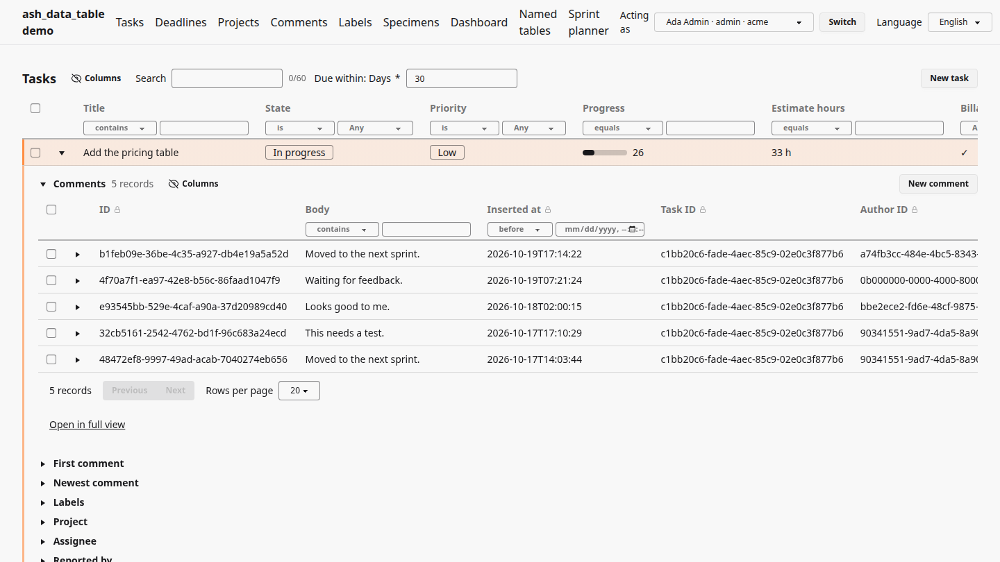
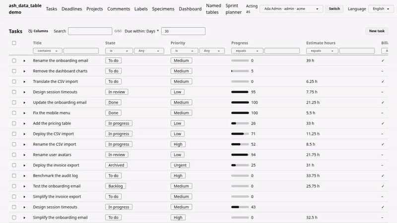
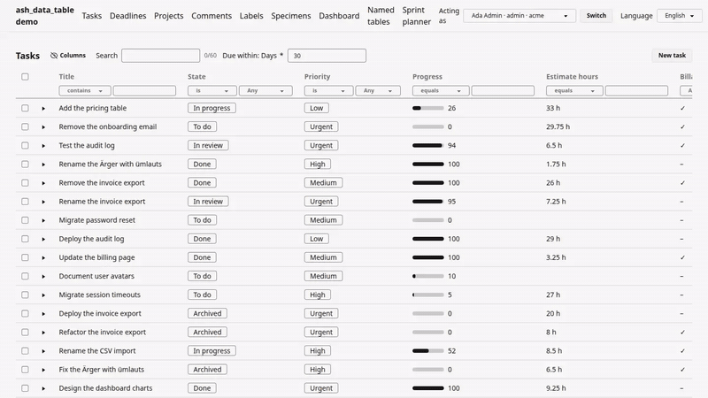
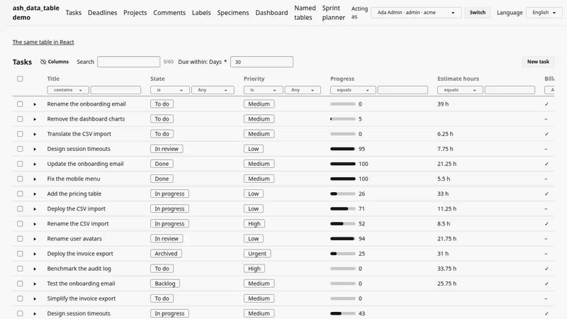
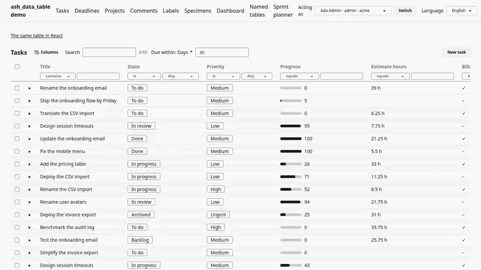
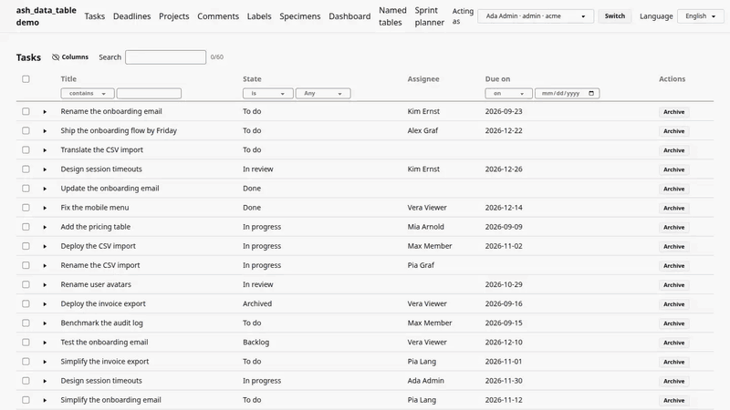
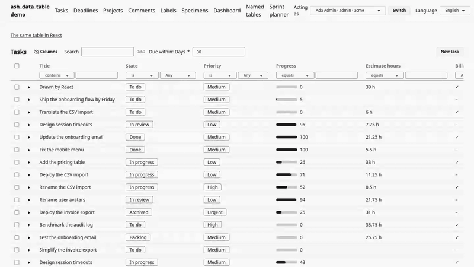

# ash_data_table

**An editable table for [Ash](https://ash-hq.org) resources, in Phoenix
LiveView — an interface to Ash for people, the way `ash_json_api` and
`ash_graphql` are interfaces for machines.**

> **Early preview, looking for feedback.** Version 0.1, not on Hex, not meant
> for production. Two questions for you: [What I'd like to know](#what-id-like-to-know).



## What it is

You add an extension to an Ash resource, optionally describe the table in a
`table do … end` block, and mount it with one line in the router. No HEEx.
The table offers what the resource offers, as the person looking may use it:
reading, sorting, filtering and paging through the read action, editing a cell
through the update action, row and table actions, related records as nested
tables. Ash's policies decide who sees and changes what.

## Try it

You need Git, Docker (for Postgres), Elixir 1.18+ and Node 20+.

```sh
git clone https://github.com/StefanRoesch/ash_data_table.git
cd ash_data_table
docker compose up -d   # Postgres on port 5477
cd demo
mix setup              # deps, database, seed data, npm packages, assets
mix phx.server
```

Then open **http://localhost:4478** and pick a person under **"Acting as"**
at the top right, for example **Ada Admin**.

**If it doesn't start:** port 4478 or 5477 is taken. Stop what uses it, or
pick other ports: `PORT` and `POSTGRES_PORT`, see `.env.example`. Or Docker
isn't running. The first `mix setup` needs internet (Hex and npm).

### In your own app

<!-- sketch -->
```sh
mix igniter.install ash_data_table@github:StefanRoesch/ash_data_table
```

This adds the dependency and sets up the formatter, config, JS hooks and
Tailwind source; you then add the extension to a resource and one router
line. Details, and the way by hand: [Installation](documentation/topics/installation.md).
The installer is tested (`test/mix/tasks/ash_data_table.install_test.exs`)
but not polished: check the diff it shows before accepting it. It expects a
fresh Phoenix 1.8 app.

## Ten minutes in the demo

The demo is a small issue tracker: projects, tasks, comments, labels, people.

1. **`/tasks`:** double-click a title (or press Enter on it), change it,
   press Enter. Escape cancels.

   

2. Open a row with its **arrow**: one line per related resource (comments,
   labels, project, …). Open one: its records appear as a nested table, a
   full table of its own.

   

3. Double-click a task's **Project** or **Assignee** cell: you choose another
   record from that resource's own table.

   

4. Use a **row action** in the last column, or **New task**: actions with
   inputs ask for them in a side panel.

   

5. **Ash's validations show where you edit.** Set a task's **State** to Done
   while its progress is under 100: the validation's message, "must be 100
   when the task is done", shows at the cell. Escape takes the change back.

   

6. **Switch persons** under "Acting as": Max Member, Vera Viewer, Olga
   Outsider (another organization) or Nobody. Columns, buttons and editable
   cells change with the resource's policies.

   

7. **`/named`:** two tables of the comments in one window, the default and
   the compact one. Change a comment's text in the first: the row changes in
   the second (**live updates**). It works across windows and persons too.

   

8. On `/tasks`, tick some rows and choose **More → Export CSV**: the
   selection is exported as CSV, through the `ash_csv_interchange`
   extension, and the browser saves the file.

   

9. Switch the language to **Deutsch**.
10. Put the mouse away and use only **Tab**, Enter, Space and Escape.
11. **`/specimens`:** one attribute of every Ash type, with nothing declared
    but the update action.
12. **`/react/tasks`:** the same table drawn with React and shadcn, to show
    the drawing can be swapped. A link above each table switches between
    the two.

    

13. **`/tasks/planner`:** the sprint planner. Tick tasks in the table; the
    cards above follow. The page and the table talk through events and
    commands.

    

More pages and what each shows:
[demo/README.md](https://github.com/StefanRoesch/ash_data_table/blob/main/demo/README.md).

## What I'd like to know

Two questions, not a review; answer where you found the link:

- **Is there a need for something like this?** Would you or your team use
  it over an Ash app, instead of building one or using `ash_admin`?
- **Is it worth polishing?** What would have to be true for you to use it?

## Known limits

- Not on Hex; the API may still change.
- The React drawing is a proof that it can be done, not polished.

## For developers

How to declare, mount and customize a table, and a guide per topic: [the documentation](documentation/README.md).

## Licence

MIT
